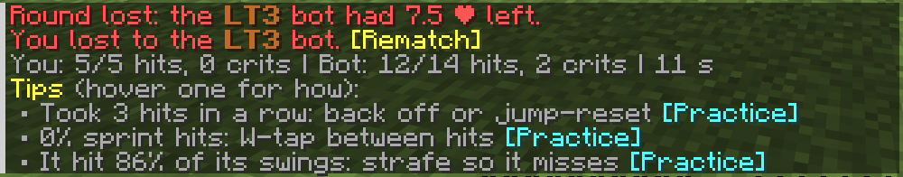

# Duel Dojo

Sword PvP practice bots for Fabric 26.3. Pick a tier from LT5 to HT1 and 1v1 the bot in a small sky
arena, either one fight or first to 10 like a tier test.

## Install

You need Fabric Loader and [Fabric API](https://modrinth.com/mod/fabric-api) for 26.3. Put the jar from
[Releases](https://github.com/Tsundosika/DuelDojo/releases) in your mods folder, join a singleplayer world
and type `/dojo`. The 1.21.8 version lives on the `mc-1.21.8` branch.

It's still a beta. If a tier feels too easy or too hard, open an issue and tell me your tier and what
`/dojo stats` says.

## Commands

- `/dojo` - pick a tier from a clickable list
- `/dojo lt3` - one fight
- `/dojo lt3 10` - first to 10
- `/dojo lt3 bo 100` - best of 100 (any number up to 100). It stops once someone can't be caught, and an even number can end in a draw
- `/dojo lt3 here` - fight right where you stand instead of in the arena
- `/dojo stats` - your wins and losses per tier
- `/dojo rank ht3` - put your own tier before your name, in chat and above your head (`/dojo rank clear` removes it)
- `/dojo path` - the drills as a course, basics first: pass each one to move on to the next
- `/dojo drill` - 45 second drills for one skill each: timing, aim, reach, combo escape, W-tap, crits, spacing, dodging, first hit, stun combo. Each starts with a short tutorial that shows the move, then lets you try it (you can skip it)
- `/dojo placement` - a few matches that find which tier you play like
- `/dojo coach` - turn the live notes above your hotbar on or off
- `/dojo watch ht1 ht2` - watch two bots fight at half speed as a spectator, with their techniques named as they use them (`0.25` at the end for quarter speed)
- `/dojo stop` - give up
- `/dojo ladder` and `/dojo sim lt3 ht3` - bots fight each other (ops only)
- `/dojo reload` - reload the config (ops only)

## How it works

You and the bot both get full diamond armor and a diamond sword. The arena is built near the build limit
above you (only in empty air) and removed after the duel, and you get your items and position back, even if
the game crashes mid-duel.

Bots show their health under their name. After every round the chat tells you how much health the winner had
left, and after every match you get up to three tips from your own numbers, like swinging before your sword is
charged, missing a lot, or letting the bot combo you. Each tip has a [Practice] button that starts a drill for
exactly that. While you fight, short notes above your hotbar tell you about early swings, whiffs, first hits
and getting out of combos, and name moves like hit selects and uppercuts when you pull them off. `/dojo stats`
shows how your numbers change over your recent matches.

  
  

Every bot has the same health and kit. The tier only changes how it plays: reaction time, aim, hit timing,
spacing, strafing, W-taps, crits, jump resets and reading your cooldown. From the middle tiers up they also
read you: they switch strafe direction when your aim catches up, fake an approach so you swing at air, wait
at the edge of your reach for you to step in, and try to knock you into the walls. Higher up they deflect your
crits, hit-select, and adapt to your habits over a series, and the chat tells you when one read you. Bots follow normal player
rules (3 block reach, 1.9 cooldown, player movement, the same delay seeing you that a person has), and the
mod doesn't give you anything for multiplayer.

| Tier | Plays like |
|---|---|
| LT5 | Swings early, panic clicks, walks straight at you |
| HT5 | Still swings early, barely strafes |
| LT4 | Better timing, starts strafing and W-tapping |
| HT4 | Keeps some distance, starts reading your cooldown |
| LT3 | Solid basics: strafes, W-taps, crits, backs out of combos |
| HT3 | Punishes your early swings, starts juking your aim and deflecting crits |
| LT2 | Jukes, baits, hit-selects, starts reading your habits |
| HT2 | Outspaces you and pushes you into walls |
| LT1 | Almost top level |
| HT1 | The best a human could do |

The gaps between tiers are based on how players are spread over a public sword tier list, and were checked
with a lot of bot vs bot fights (`/dojo ladder`). All the bot settings are in `config/dueldojo-tiers.json` if
you want to tune them.

## Building

`./gradlew build` (needs JDK 25). The jar ends up in `build/libs`.

## License

MIT, see [LICENSE](LICENSE) and [THIRD_PARTY_NOTICES.md](THIRD_PARTY_NOTICES.md). Not an official
Minecraft product, not affiliated with Mojang or Microsoft.
