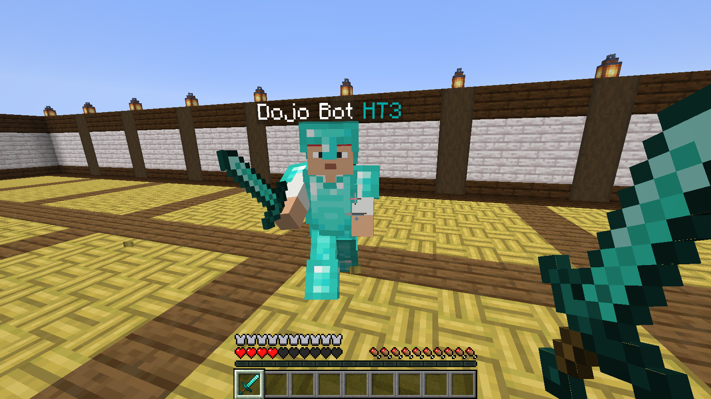
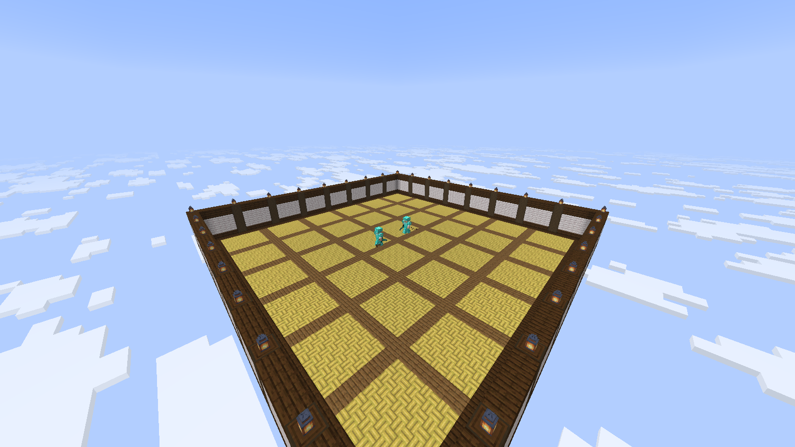
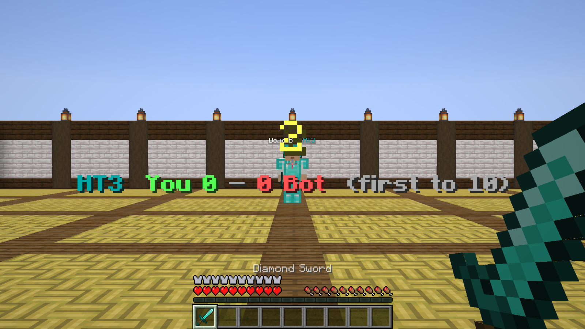

# Duel Dojo

Sword PvP practice bots for Fabric 1.21.8. Pick a tier from LT5 to HT1 and 1v1 the bot in a small sky
arena, either one fight or first to 10 like a tier test.

## Install

You need Fabric Loader and [Fabric API](https://modrinth.com/mod/fabric-api) for 1.21.8. Put the jar from
[Releases](https://github.com/Tsundosika/DuelDojo/releases) in your mods folder, join a singleplayer world
and type `/dojo`.

It's still a beta. If a tier feels too easy or too hard, open an issue and tell me your tier and what
`/dojo stats` says.

## Commands

- `/dojo` - pick a tier from a clickable list
- `/dojo lt3` - one fight
- `/dojo lt3 10` - first to 10
- `/dojo lt3 here` - fight right where you stand instead of in the arena
- `/dojo stats` - your wins and losses per tier
- `/dojo stop` - give up
- `/dojo ladder` and `/dojo sim lt3 ht3` - bots fight each other (ops only)
- `/dojo reload` - reload the config (ops only)

## How it works

You and the bot both get full diamond armor and a diamond sword. The arena is built near the build limit
above you (only in empty air) and removed after the duel, and you get your items and position back, even if
the game crashes mid-duel.

  
  

Every bot has the same health and kit. The tier only changes how it plays: reaction time, aim, hit timing,
spacing, strafing, W-taps, crits, jump resets and reading your cooldown. Bots follow normal player rules
(3 block reach, 1.9 cooldown, player movement), and the mod doesn't give you anything for multiplayer.

| Tier | Plays like |
|---|---|
| LT5 | Swings early, panic clicks, walks straight at you |
| HT5 | Still swings early, barely strafes |
| LT4 | Better timing, starts strafing and W-tapping |
| HT4 | Keeps some distance, starts reading your cooldown |
| LT3 | Solid basics: strafes, W-taps, crits |
| HT3 | Punishes your early swings |
| LT2 | Clean aim, rarely wastes a hit |
| HT2 | Outspaces you |
| LT1 | Almost top level |
| HT1 | The best a human could do |

The gaps between tiers are based on how players are spread over a public sword tier list, and were checked
with a lot of bot vs bot fights (`/dojo ladder`). All the bot settings are in `config/dueldojo-tiers.json` if
you want to tune them.

## Building

`./gradlew build` (Gradle needs JDK 25, the mod itself runs on Java 21). The jar ends up in `build/libs`.

## License

MIT, see [LICENSE](LICENSE) and [THIRD_PARTY_NOTICES.md](THIRD_PARTY_NOTICES.md). Not an official
Minecraft product, not affiliated with Mojang or Microsoft.
